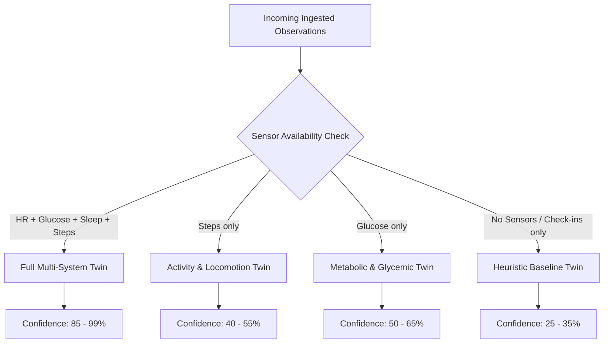

# ADAPTIVE TWIN ENGINE & DYNAMIC MODELING ANALYSIS
## Beyond Horizon — Physiological Adaptation Framework

**Date**: October 15, 2026  
**Module**: `com.example.humandigitaltwin.data.engine.AdaptiveTwinEngine`

---

## 1. Operating Modes & Model Activation Rules

Rather than maintaining a monolithic score calculation that assumes continuous multi-sensor availability, the Beyond Horizon Twin Engine dynamically configures its physiological models:

### 1.1 `FULL_TWIN` (Full Multi-System Twin)
- **Active Domains**: Cardiovascular (HR/HRV), Metabolic (CGM/Nutrition), Sleep Architecture, Locomotion.
- **Biomarkers Computed**: Health Score, Biological Age, Autonomic Recovery Index, Metabolic Flexibility.
- **Confidence Rating**: $85.0\% - 99.0\%$.

### 1.2 `ACTIVITY_ONLY` (Activity & Locomotion Twin)
- **Active Domains**: Daily step counts, active calories.
- **Suppressed Domains**: Cardiovascular strain, recovery index, glycemic spikes.
- **Clinical Display**: Cardiovascular cards display: *"Insufficient Data — Connect BLE chest strap or Health Connect to activate cardiac modeling."*
- **Confidence Rating**: $40.0\% - 55.0\%$.

### 1.3 `METABOLIC_FOCUSED` (Metabolic & Glycemic Twin)
- **Active Domains**: Interstitial glucose excursions, time-in-range (TIR), meal glycemic impact.
- **Suppressed Domains**: Autonomic recovery, continuous cardiac efficiency.
- **Confidence Rating**: $50.0\% - 65.0\%$.

### 1.4 `BASELINE_ONLY` (Heuristic Baseline Twin)
- **Active Domains**: Self-reported symptom scores, pain scale, temperature check-ins, synthetic population priors.
- **Behavior**: Strictly flagged as *"Offline Baseline Demo"* with explicit notices that objective hardware telemetry is disconnected.
- **Confidence Rating**: Baseline prior of $25.0\%$.

---

## 2. Personal Baselines vs. Population Percentiles

### 2.1 Rolling Personal Baseline
The engine computes rolling statistics over configurable windows ($7$, $14$, or $30$ days):
$$\mu = \frac{1}{N} \sum_{i=1}^N x_i \qquad \sigma = \sqrt{\frac{1}{N-1}\sum_{i=1}^N (x_i - \mu)^2}$$

Deviations are explicitly framed in user context:
> *"Your resting heart rate is +4.4 bpm above your 14-day baseline (60.5 bpm)."*

### 2.2 Population Norms
Population comparisons derive from age- and demographic-matched reference distributions (e.g. Adult 30–40):
- Resting HR $< 55\text{ bpm}$: *Top 10th percentile (Athletic)*
- Resting HR $55 - 65\text{ bpm}$: *75th percentile (Above Average)*
- Resting HR $65 - 75\text{ bpm}$: *50th percentile (Normal Adult)*
- Blood Glucose $70 - 99\text{ mg/dL}$: *Euglycemic Fasting Reference (Normal)*

---

## 3. Adaptive AI Health Companion Integration

The Digital Nurse companion is directly wired to the `AdaptiveTwinSummary`:
- **Context Awareness**: The companion receives real-time knowledge of which sensors are physically paired vs. missing.
- **Refusal to Hallucinate**: If asked *"How did I sleep last night?"* when no sleep tracker is linked, the AI responds:
  > *"Notice: A sleep tracking sensor is not yet connected to your digital twin. Connect Android Health Connect or an Oura/Whoop device in the Device Hub to capture restorative sleep architecture."*
- **Actionable Clinical Direction**: Guides users to pair missing hardware to increase overall model precision.
